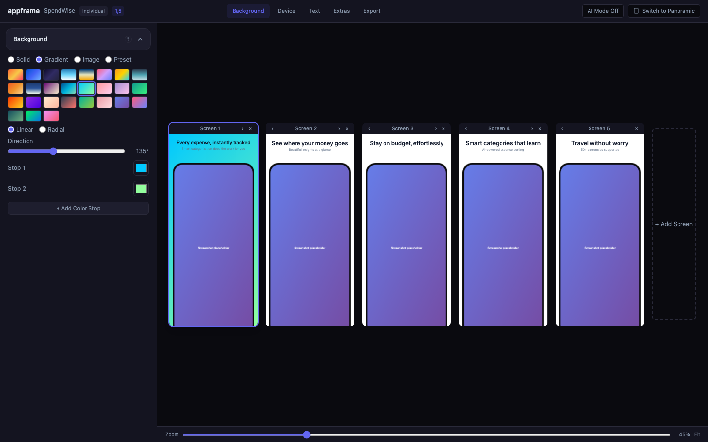
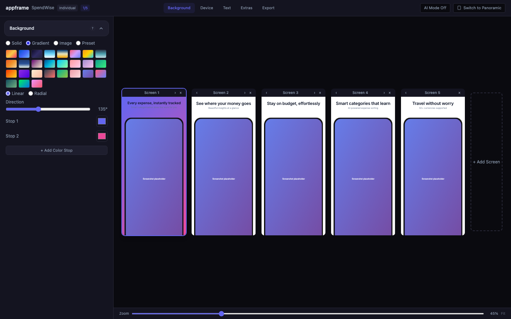
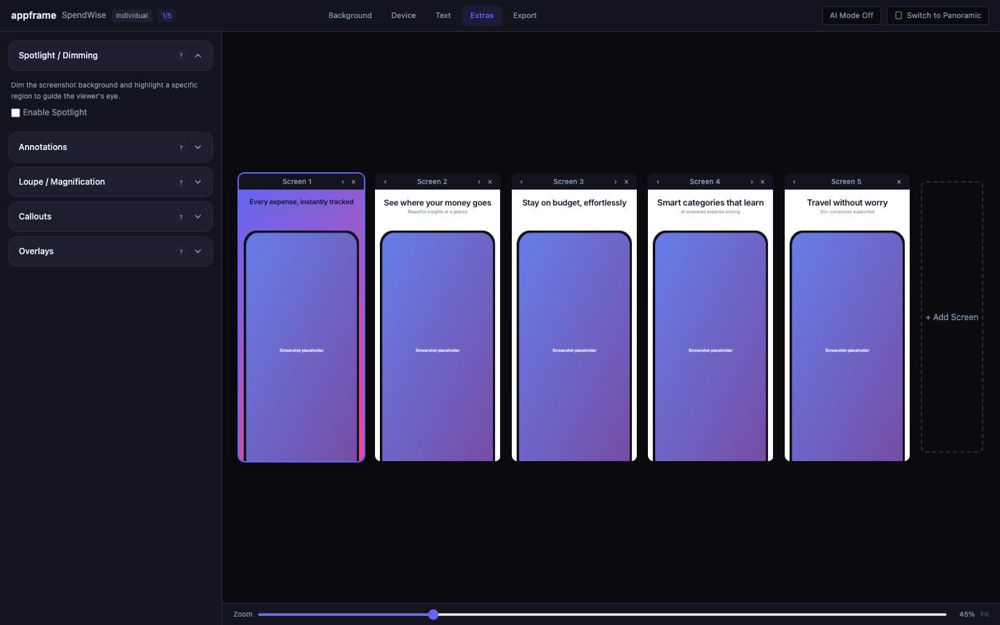
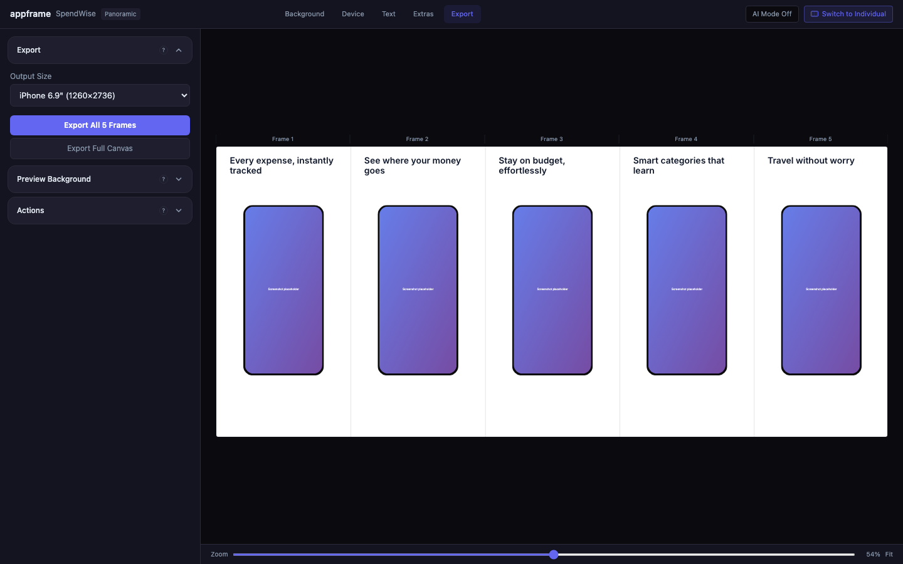
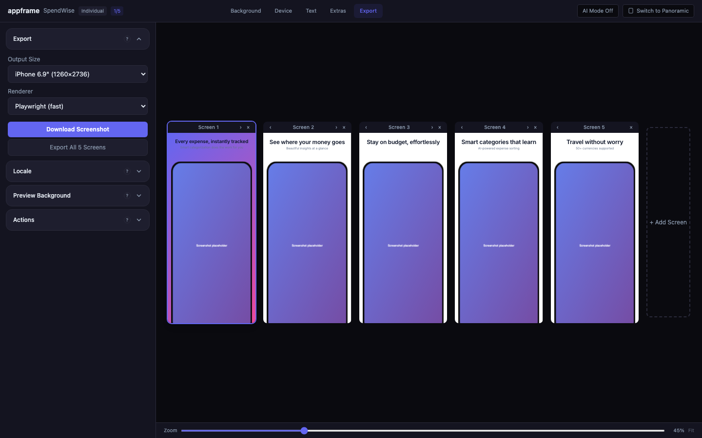

# appframe

Editor local de código abierto para generar capturas de pantalla promocionales profesionales para App Store y Play Store.

Toma las capturas de pantalla crudas de tu aplicación, arrástralas a un editor local basado en el navegador, embébelas con marcos de dispositivo, titulares, fondos estilizados y composiciones profesionales, y exporta PNGs listos para las tiendas.

<p align="center">
  
</p>

## Las capturas de pantalla son anuncios, no documentación

El error #1 que cometen los desarrolladores con las capturas de pantalla de las tiendas: mostrar la interfaz de usuario en lugar de vender resultados. Cada captura debe vender **una idea**. No estás documentando funciones; estás vendiendo una sensación, un resultado o solucionando un punto de dolor.

**Bueno**: "Nunca más te perderás un entrenamiento." (soluciona un dolor)
**Malo**: "Visualiza el historial de tus entrenamientos con filtros, etiquetas y sincronización del calendario" (lista de funciones)

Consulta [Redactando un excelente texto](#writing-great-copy) a continuación.

## Características

- **8 estilos de plantilla**: minimalista, audaz, resplandor, lúdico, limpio, con marca, editorial, pantalla completa
- **9 presets de composición**: individual, asomado-derecha/izquierda, inclinado-derecha/izquierda, dúo-superpuesto, dúo-dividido, héroe-inclinado, tarjetas-abanico
- **Marcos de dispositivo incluidos**: un puñado de marcos SVG para iPhone, iPad y Android; el catálogo es intencionalmente pequeño; la revisión de calidad de los marcos incluidos es una tarea pendiente abierta. La integración con Koubou (opcional, instalada externamente) permite acceder a un catálogo más grande de marcos fotorrealistas.
- **Salida multiplataforma**: iOS, Android, Mac y Apple Watch en las dimensiones exactas requeridas por las tiendas
- **Soporte multiidioma**: texto, tipografía, posición y capturas de pantalla por idioma, todo editable lado a lado
- **Variantes**: lienzos alternativos dentro de un proyecto, cada uno con su propia miniatura, entre los que puedes alternar para comparar
- **Primero local**: todo reside en `~/Documents/appframe/projects/<slug>/` — sin nube, sin cuenta, sin telemetría
- **Fuentes web incluidas**: inter, space-grotesk, poppins, montserrat, dm-sans, plus-jakarta-sans, raleway, playfair-display

## Inicio Rápido

```bash
git clone https://github.com/andresdefi/appframe.git
cd appframe
pnpm install
pnpm build
pnpm preview
```

Luego abre http://localhost:4400. El editor crea automáticamente un proyecto `Untitled 1` con tres pantallas de marcador de posición en el primer lanzamiento.

## Qué hace el editor

### Controles de fondo, dispositivo y texto

Configura fondos (sólido, degradado, imagen o preset), selecciona marcos de dispositivo y plataformas, edita titulares y subtítulos, y ajusta la tipografía, todo con retroalimentación visual instantánea.

<p align="center">
  
  
</p>
<p align="center">
  
  
</p>

### Modo panorámico

Cambia al modo panorámico para un diseño de lienzo continuo donde los elementos pueden extenderse más allá de los límites del marco — ideal para crear una historia visual cohesiva a través de todas tus capturas de pantalla de la App Store.

<p align="center">
  
</p>

### Exportar

Elige los tamaños de salida para cualquier clase de dispositivo y exporta pantallas individuales o todas a la vez. Los proyectos multiidioma producen un ZIP con una carpeta por idioma; los proyectos de un solo idioma mantienen los archivos planos en la raíz del archivo.

<p align="center">
  
</p>

## Redactando un excelente texto

Escribe todos los titulares **antes** de diseñar los maquetados. Un mal texto arruina un buen diseño.

### Tres enfoques

Usa uno por diapositiva:

| Enfoque | Qué hace | Ejemplo |
|----------|-------------|---------|
| **Pinta un momento** | El lector se imagina haciéndolo | "Verifica tu café sin abrir la aplicación." |
| **Plantea un resultado** | Cómo se ve la vida después | "Un hogar para cada café que compras." |
| **Elimina un dolor** | Nombra un problema y destrúyelo | "Nunca desperdicies una gran bolsa de café." |

### Las reglas

1. **Una idea por titular.** Nunca unes dos cosas con "y".
2. **Palabras cortas y comunes.** 1-2 sílabas. Sin jerga a menos que sea específica del dominio.
3. **3-5 palabras por línea.** Debe ser legible al tamaño de miniatura en la App Store.
4. **Los saltos de línea son intencionales.** Usa los saltos de línea del editor de titulares para controlar dónde se rompen.

### Lo que nunca funciona

- Listas de funciones: "Registra cada elemento con etiquetas, categorías y notas"
- Dos ideas con "y": "Controla gastos y nunca te pierdas un pago"
- Aspiracional vago: "Cada momento, capturado"
- Palabras de moda de marketing: "Análisis impulsados por IA" (a menos que realmente lo sea)

### Estructura de diapositivas

| Posición | Propósito |
|------|---------|
| #1 | **Héroe** — beneficio principal de la app, la una cosa que hace mejor |
| #2 | **Diferenciador** — qué lo hace único frente a alternativas |
| #3 | **Ecosistema** — widgets, reloj, extensiones (omitir si no aplica) |
| #4+ | **Funciones principales** — una por diapositiva, más importantes primero |
| Penúltima | **Señal de confianza** — "hecho para personas que [X]" |
| Última | **Resumen** — funciones restantes o próximamente |

## Estilos de plantilla

| Estilo | Descripción | Mejor para |
|-------|-------------|----------|
| **minimalista** | Limpio, claro, estilo Apple con sombras sutiles | Productividad, finanzas, salud, utilidades |
| **audaz** | Degradados vibrantes, tipografía grande y pesada, mayúsculas | Redes sociales, entretenimiento, estilo de vida |
| **resplandor** | Oscuro premium con acentos de color luminosos | Finanzas, herramientas profesionales, música, fotografía |
| **lúdico** | Formas coloridas, decoraciones divertidas | Juegos, educación, niños, casual |
| **limpio** | Cero decoración, solo texto + dispositivo | Look moderno sin adornos (YouTube, Uber) |
| **con marca** | Color de marca fuerte como fondo | Apps con identidad de marca fuerte |
| **editorial** | Tonos elegantes y apagados, títulos en cursiva | Estilo de vida, bienestar, premium |
| **pantalla completa** | Captura de pantalla a todo color, sin marco de dispositivo | Apps inmersivas |

## Presets de composición

Varía los maquetados entre diapositivas; nunca uses la misma composición para cada captura de pantalla.

| Preset | Dispositivos | Efecto |
|--------|---------|--------|
| `single` | 1 | Dispositivo centrado por defecto |
| `peek-right` | 1 | El dispositivo se desborda por el borde derecho |
| `peek-left` | 1 | El dispositivo se desborda por el borde izquierdo |
| `tilt-left` | 1 | Inclinación dramática desbordándose a la izquierda |
| `tilt-right` | 1 | Inclinación dramática desbordándose a la derecha |
| `duo-overlap` | 2 | Dos dispositivos superpuestos |
| `duo-split` | 2 | Dos dispositivos en bordes opuestos |
| `hero-tilt` | 2 | Héroe grande + dispositivo de fondo más pequeño |
| `fanned-cards` | 3 | Tres dispositivos en abanico |

Los presets de composición establecen la posición inicial del dispositivo; ajusta a escala, rotación, desplazamiento y ángulo desde allí en la pestaña Dispositivo.

**Consejo**: Combina `peek-right` en una diapositiva con `peek-left` en la siguiente; cuando se ven en la App Store, los dispositivos parecen extenderse a través de las capturas de pantalla.

## Tamaños de salida

### iOS (App Store)

| Pantalla | Tamaño de salida |
|---------|-------------|
| iPhone 6.9" | 1260 x 2736 |
| iPhone 6.5" | 1284 x 2778 |
| iPhone 6.3" | 1206 x 2622 |
| iPad 13" | 2064 x 2752 |
| iPad 12.9" | 2048 x 2732 |
| iPad 11" | 1668 x 2388 |

### Android (Google Play)

| Pantalla | Tamaño de salida |
|---------|-------------|
| Teléfono | 1080 x 1920 |
| Tableta 7" | 1200 x 1920 |
| Tableta 10" | 1800 x 2560 |
| Gráfico principal | 1024 x 500 |

## Almacenamiento del proyecto

Cada proyecto reside en `~/Documents/appframe/projects/<slug>/`:

- **`appframe.json`** — estado completo del proyecto (pantallas, variantes, datos panorámicos, instantáneas por idioma).
- **`meta.json`** — índice pequeño (nombre para mostrar, marcas de tiempo).
- **`screenshots/`** — archivos de capturas de pantalla subidos referenciados por `appframe.json`.

Los archivos se escriben de forma atómica (`.tmp` + renombrado), por lo que un cierre inesperado en medio del guardado nunca corrompe un proyecto.

## `/api/config` en vivo

Mientras el servidor de vista previa está en ejecución, el estado completo del editor se expone en modo de solo lectura en `http://localhost:4400/api/config`. Las herramientas y agentes en la misma máquina pueden consultarlo para ver qué está mostrando el editor actualmente; útil para pipelines de compilación o flujos de revisión automatizados. El endpoint está vinculado solo a `127.0.0.1` por defecto; se rechazan las solicitudes de origen cruzado.

## Desarrollo

```bash
pnpm typecheck      # tsc para core + web-preview (servidor + cliente)
pnpm lint           # ESLint sobre packages/*/src/**/*.{ts,tsx}
pnpm test           # Unitarios + integración con Vitest
pnpm build          # Compilar ambos paquetes
pnpm preview        # Iniciar el editor web local en http://localhost:4400
pnpm dev            # Modo vigilancia (paralelo entre paquetes)
pnpm test:e2e       # Pruebas end-to-end con Playwright (solo desarrollo)
```

### Estructura del proyecto

```
packages/
  core/           Esquema de configuración, motor de plantillas, pipeline de renderizado, gestión de marcos
  web-preview/    Servidor Express + UI del editor React/Vite
frames/           Marcos de dispositivo SVG incluidos + manifiesto
fonts/            Fuentes web de código abierto incluidas
docs/             Planes + capturas de pantalla
```

## Requisitos

- Node.js `^20.19.0 || ^22.13.0 || >=24.0.0`
- pnpm 9.15+ (campo `packageManager` del repositorio)
- Un navegador moderno basado en Chromium (Safari y Firefox también funcionan)

## Licencia

MIT — consulta [LICENSE](LICENSE).

Las obras de arte incluidas de creadores de terceros (flechas dibujadas a mano, iconos de Lucide, marcos de dispositivo, fuentes) conservan su licencia original. Consulta [NOTICE.md](NOTICE.md) para detalles de atribución y licencia.
